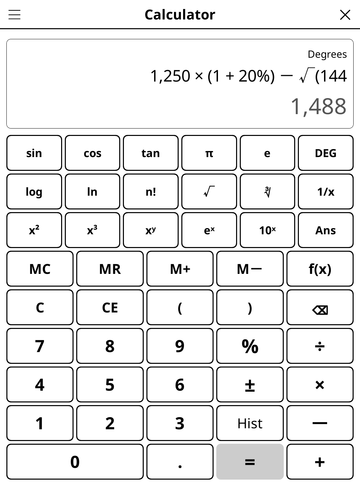

# quickcalc.koplugin

A calculator for [KOReader](https://github.com/koreader/koreader), with
scientific keys, memory and history, plus fill-in forms for VAT and
percentages, splitting a bill, and loans and savings.

Open it from **Tools → Calculator**.

## Screenshot

## Calculator

- **Type it as you write it** — 2 + 3 × 4 gives 14; parentheses nest, and the
  ones left open are closed by **=**.
- **Live result** — the value shows in grey while you type; **=** prints it in
  black and adds the calculation to the history.
- **After =** — a digit starts a new calculation, an operator carries on from
  the result, and √, x², 1/x… apply to the result.
- **Pocket-calculator %** — 200 + 10 % = 220, 200 × 10 % = 20.
- **Editing** — ± flips the sign of the number being typed, ⌫ erases the last
  key (hold it to clear everything), CE the number being typed, C everything.
- **Memory** — MC, MR, M+, M−; the display shows what memory holds.
- **History** — the last 20 results, kept when you close the calculator; tap
  one to put its value back into the calculation.
- **Local number format** — decimal comma and thin-space thousands in French
  (1 234,5), point and comma in English (1,234.5).
- **Errors in words** — division by zero, overflow (from 10¹⁰⁰) and undefined
  results (√−1, ln 0, tan 90°, 2.5!) are reported instead of a number.

### Scientific keys

Tap **f(x)** for √, ∛, x², x³, xʸ, 1/x, eˣ, 10ˣ, n!, π, e and Ans, sin / cos /
tan in degrees or radians (**DEG/RAD**), log (base 10) and ln.

## Forms

Pick a mode from the **☰** menu. Tap a field to type into it on the keypad;
▲ / ▼ move between fields. Results update as you type.

| Mode | Fields | Results |
|------|--------|---------|
| Percentages · VAT | amount excl. or incl. VAT, rate (5.5 / 10 / 20 % presets) | excl. VAT, VAT, incl. VAT |
| Percentages · Discount | price, discount % | final price, saving |
| Percentages · % change | initial and final value | change %, difference |
| Percentages · X % of Y | X, Y | X % of Y, Y + X %, Y − X % |
| Bill split & tip | total, people, tip % | tip, total with tip, per person |
| Loan & savings · Loan | amount, annual rate, duration (years or months) | monthly payment, total repaid, total interest |
| Loan & savings · Savings | initial amount, annual rate, duration, monthly deposit | final balance, total deposited, interest earned |

Loans are repaid in equal monthly payments; savings are compounded monthly,
deposits made at the end of each month. The last mode and every value are
remembered.

## Safe by design

Expressions are evaluated by the plugin's own parser over the keys you
pressed — nothing you type is ever run as Lua code.

## Why e-ink friendly?

Big, high-contrast keys and no animation. A key press repaints only the
display (or the form above the keypad), never the whole screen.

## License

GPL-3.0
